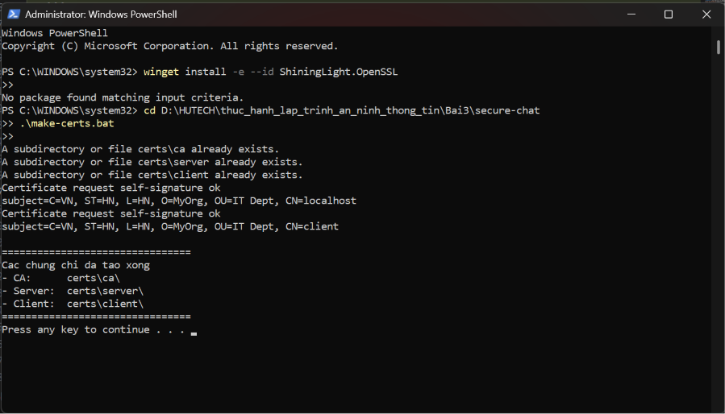
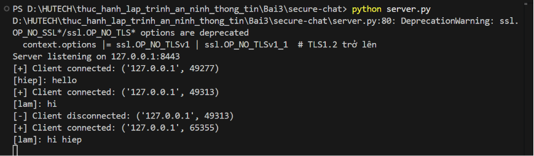
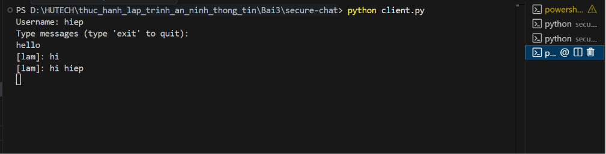
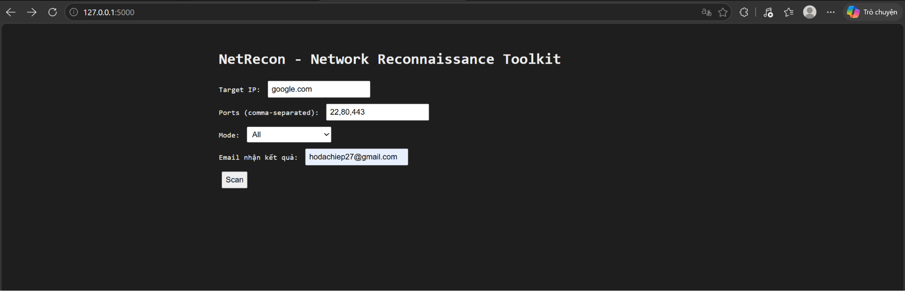
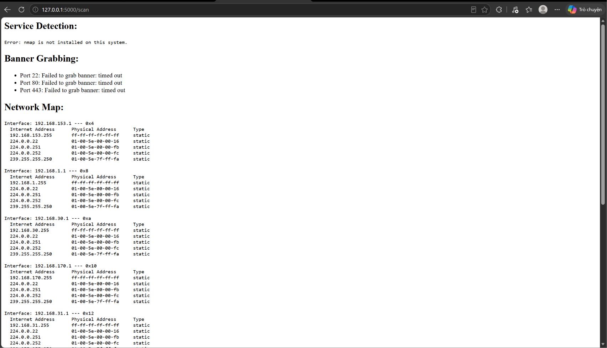
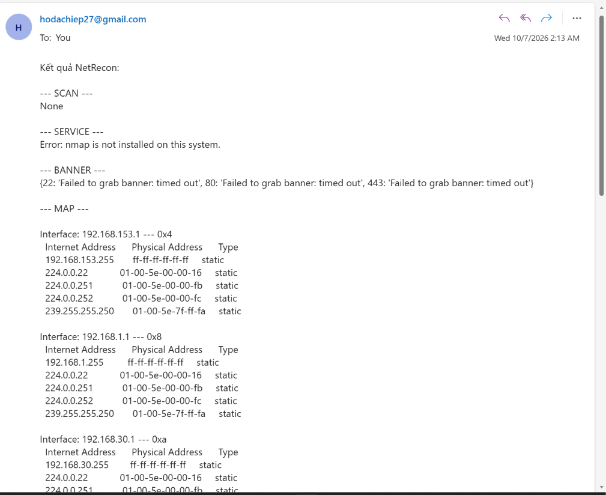

**TRƯỜNG ĐẠI HỌC CÔNG NGHỆ TP HCM**  
**KHOA CÔNG NGHỆ THÔNG TIN**  
**Môn:** Thực hành Lập trình An ninh Thông tin  

---

# BÁO CÁO BÀI 3

**Họ Và Tên:** Hồ Đắc Hiệp  
**MSSV:** 2380600634  
**Lớp:** 23DATA1  

---

# 🌐 Bài 3 — Bảo Mật Mạng Máy Tính & Ứng Dụng

## 📋 Mục lục

- [Giới thiệu](#giới-thiệu)
- [Tổng quan công cụ](#tổng-quan-công-cụ)
- [1. Ứng dụng Secure-Chat](#1-ứng-dụng-secure-chat---mã-hóa-đầu-cuối)
- [2. Công cụ NetRecon](#2-công-cụ-netrecon---quét-mạng-và-phát-hiện-lỗ-hổng)
- [Kết luận](#kết-luận)

---

## Giới thiệu

**Báo cáo Bài 3** tập trung vào việc triển khai và kiểm thử hai ứng dụng liên quan đến An ninh Mạng:
1. **Secure-Chat**: Ứng dụng mô phỏng Chat nhóm có sử dụng kết nối bảo mật qua Socket, áp dụng chứng chỉ SSL/TLS và thuật toán mã hóa đối xứng AES.
2. **NetRecon**: Ứng dụng Web viết bằng Flask, kết hợp cùng các công cụ như Nmap để quét cổng (port), trích xuất banner (banner grabbing), vẽ bản đồ mạng (network mapping) và kiểm tra các lỗ hổng đã biết trên các cổng mạng.

Báo cáo trình bày chi tiết cách thiết lập môi trường, cách vận hành ứng dụng và kết quả kiểm thử.

---

## Tổng quan công cụ

| STT | Ứng dụng | Mô tả chức năng chính | Mức độ |
|---|---|---|---|
| 1 | `secure-chat` | Chat mã hóa RSA/AES qua Socket. | 🟢 Xong |
| 2 | `netrecon` | Quét cổng Async, Nmap, Gửi Email. | 🟢 Xong |

---

## 1. Ứng dụng Secure-Chat - Mã hóa đầu cuối

Ứng dụng **Secure-Chat** được thiết kế để chống lại các hình thức tấn công nghe lén (Sniffing) và giả mạo (Man-in-the-Middle) bằng cách sử dụng chứng chỉ số do chính CA tự cấp và luồng dữ liệu được mã hoá.

### 1.1. Khởi tạo chứng chỉ bảo mật (PKI)

Trước khi khởi động server, chúng tôi sử dụng công cụ **OpenSSL** để sinh khóa RSA (2048 bit) và tạo chứng chỉ (`.crt`) cho CA, Server và Client. 

- **Mã lệnh thực thi:**
```powershell
# Chạy tập lệnh tạo chứng chỉ tự động
.\make-certs.bat
```
- **Minh chứng tạo chứng chỉ:**



### 1.2. Vận hành Server và Client

Hệ thống cho phép nhiều Client kết nối đồng thời tới Server (port 8443) để trò chuyện thông qua cơ chế quản lý Room Manager.
- Khởi động Server: `python server.py`
- Khởi động Client: `python client.py` (Nhập Username và kết nối)

#### Hình ảnh minh chứng Server


#### Hình ảnh minh chứng Client nhắn tin


---

## 2. Công cụ NetRecon - Quét mạng và Phát hiện lỗ hổng

**NetRecon** là một trình quét mạng tích hợp. Người dùng thao tác qua trình duyệt Web, Server (Flask) tiếp nhận yêu cầu và điều phối các module bên dưới (`port_scanner`, `service_detector`,...) để xử lý, sau đó tổng hợp gửi qua Email.

### 2.1. Cài đặt và Khởi động

Môi trường yêu cầu các thư viện như `flask`, `python-dotenv`. Thư viện bị lỗi `htmx` đã được loại bỏ khỏi `requirements.txt` để đảm bảo cài đặt suôn sẻ. 

- **Lệnh thực thi:**
```powershell
pip install -r requirements.txt
python app.py
```
*Truy cập tại địa chỉ: `http://127.0.0.1:5000/`*

#### Hình ảnh Giao diện trang chủ (Home)


### 2.2. Kết quả Quét Mạng (Scan Result)

Khi nhập IP (VD: `127.0.0.1`), hệ thống sẽ:
1. Quét các port đã chỉ định bất đồng bộ (nhanh chóng).
2. Phát hiện Service (Nếu chưa có Nmap, hệ thống sẽ tự động bắt lỗi `FileNotFoundError` và báo cáo thiếu nmap).
3. Grab banner của Service.
4. Đối chiếu lỗ hổng cơ bản qua danh sách CVE.
5. In ra bảng định tuyến / ARP của mạng.

#### Hình ảnh Kết quả trên Web


### 2.3. Báo cáo qua Email tự động

Bằng cách thiết lập thông tin đăng nhập trong file `.env` (Sử dụng App Password của Google), hệ thống tự động đăng nhập SMTP qua giao thức bảo mật SSL và gửi chuỗi kết quả về email người dùng yêu cầu.

#### Hình ảnh Minh chứng nhận được Email


---

## Kết luận

Qua bài thực hành số 3, các khái niệm về lập trình mạng bảo mật đã được áp dụng vào thực tế:
- **Tự xây dựng hạ tầng khóa công khai thu nhỏ (PKI)** để bảo vệ đường truyền ứng dụng Chat.
- **Áp dụng Asyncio trong Python** để gia tăng tốc độ quét mạng, xử lý đồng thời nhiều Port.
- **Quản lý biến môi trường bảo mật (`.env`)** để che giấu mật khẩu ứng dụng Gmail khi cấu hình gửi mail tự động. 
- Xử lý mượt mà các trường hợp ngoại lệ (Exceptions) khi gọi tiến trình con (subprocess) của hệ điều hành.
