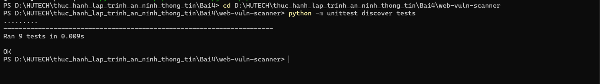
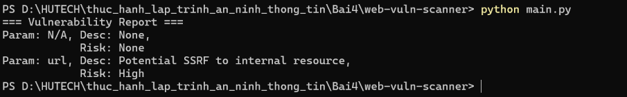
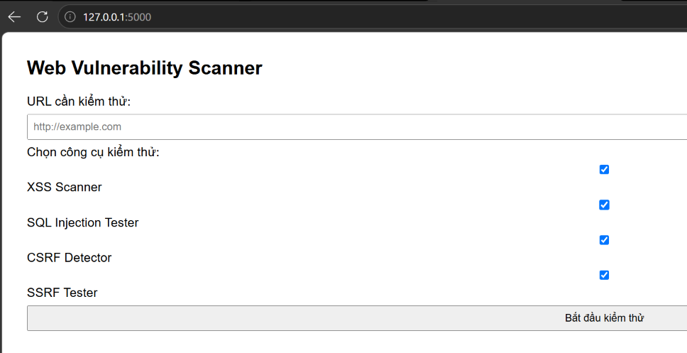
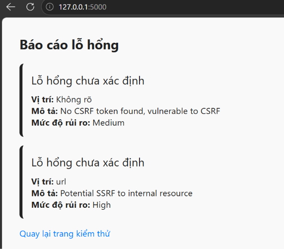
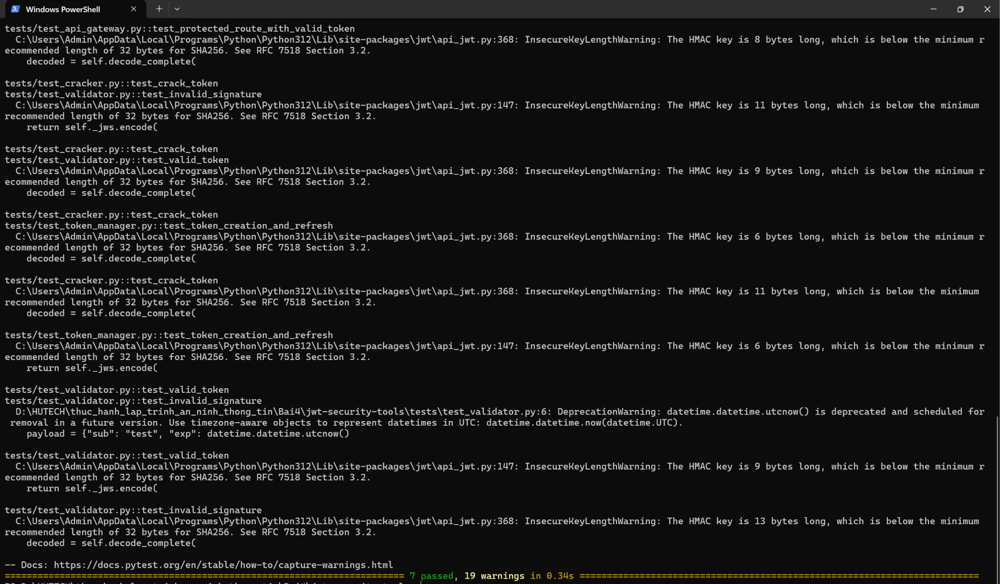
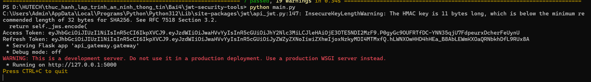
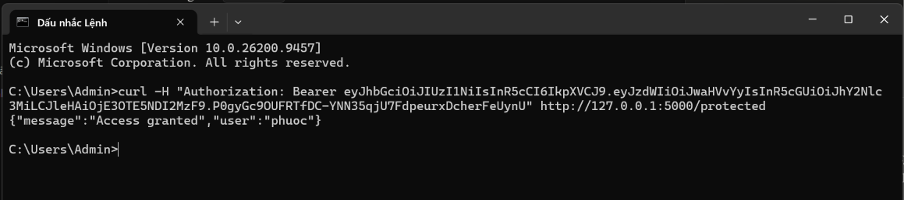

**TRƯỜNG ĐẠI HỌC CÔNG NGHỆ TP HCM**  
**KHOA CÔNG NGHỆ THÔNG TIN**  
**Môn:** Thực hành Lập trình An ninh Thông tin  

---

# BÁO CÁO BÀI 4

**Họ Và Tên:** Hồ Đắc Hiệp  
**MSSV:** 2380600634  
**Lớp:** 23DATA1  

---

# 🔒 Bài 4 — Bảo Mật Web App và API

## 📋 Mục lục

- [Giới thiệu](#giới-thiệu)
- [Tổng quan công cụ](#tổng-quan-công-cụ)
- [1. Web Vulnerability Scanner](#1-web-vulnerability-scanner---quét-lỗ-hổng-web)
- [2. JWT Security Tools](#2-jwt-security-tools---bảo-mật-jwt--oauth)
- [Kết luận](#kết-luận)

---

## Giới thiệu

**Báo cáo Bài 4** tập trung vào việc triển khai và kiểm thử hai bộ công cụ liên quan đến bảo mật ứng dụng Web và API:

1. **web-vuln-scanner**: Công cụ quét lỗ hổng web, phát hiện 4 loại lỗ hổng phổ biến gồm **XSS** (Cross-Site Scripting), **SQL Injection**, **CSRF** (Cross-Site Request Forgery) và **SSRF** (Server-Side Request Forgery), kèm bộ tạo báo cáo và giao diện web viết bằng Flask.
2. **jwt-security-tools**: Bộ công cụ bảo mật **JWT** (JSON Web Token) và **OAuth 2.0**, gồm kiểm tra tính hợp lệ của token, dò khóa bí mật yếu, quản lý vòng đời token, client OAuth và cổng API có xác thực JWT.

Báo cáo trình bày chi tiết cách thiết lập môi trường, cách vận hành và kết quả kiểm thử của từng công cụ.

---

## Tổng quan công cụ

| STT | Dự án | Các module chính | Kiểm thử | Mức độ |
|---|---|---|---|---|
| 1 | `web-vuln-scanner` | XSSScanner, SQLInjectionTester, CSRFDetector, SSRFTester, ReportGenerator, Flask UI | `unittest` (9 test) | 🟢 Xong |
| 2 | `jwt-security-tools` | JWTValidator, JWTCracker, OAuthClient, TokenManager, APIGateway | `pytest` (7 test) | 🟢 Xong |

---

## 1. Web Vulnerability Scanner - Quét lỗ hổng web

Công cụ **web-vuln-scanner** mô phỏng một trình quét lỗ hổng web cơ bản. Mỗi loại lỗ hổng được tách thành một module riêng trong thư mục `scanners/`, kết quả được gộp lại bởi `ReportGenerator` và hiển thị qua CLI hoặc giao diện web Flask.

**Các chức năng chính:**
- **XSSScanner**: chèn payload (`<script>alert(1)</script>`, `'><svg/onload=alert(1)>`) vào tham số URL và kiểm tra payload có bị phản hồi nguyên văn hay không → mức rủi ro `HIGH`.
- **SQLInjectionTester**: đối chiếu giá trị từng tham số với danh sách payload SQLi phổ biến → mức rủi ro `Critical`.
- **CSRFDetector**: dùng regex tìm CSRF token trong HTML; không có token → cảnh báo `vulnerable`, mức `Medium`.
- **SSRFTester**: kiểm tra tham số có trỏ tới dải IP nội bộ (`127.0.0.1`, `localhost`, `10.x`, `192.168.x`, `172.16–31.x`) → mức rủi ro `High`.
- **ReportGenerator**: tổng hợp kết quả thành báo cáo thống nhất.

### 1.1. Cài đặt môi trường

Mở terminal (PowerShell) tại thư mục `Bai4` và cài thư viện:

```powershell
pip install -r web-vuln-scanner/requirements.txt
```

### 1.2. Kiểm thử tự động (Unit Test)

Dự án dùng `unittest` với 9 test case bao phủ cả 5 module (XSS, SQLi, CSRF, SSRF, Report).

```powershell
cd web-vuln-scanner
python -m unittest discover tests
```

**Kết quả kiểm thử — toàn bộ 9/9 test PASS:**



### 1.3. Chạy chương trình chính (CLI)

File `main.py` chạy thử các bộ quét trên dữ liệu mẫu và in báo cáo ra màn hình:

```powershell
python main.py
```

**Kết quả báo cáo lỗ hổng trên terminal:**



### 1.4. Giao diện web (Flask UI)

Chạy giao diện web để kiểm thử trực quan:

```powershell
python .\ui\app.py
```

Truy cập tại địa chỉ: `http://127.0.0.1:5000/`

#### Hình ảnh trang chủ (nhập URL và chọn công cụ kiểm thử)



#### Hình ảnh kết quả quét

Khi nhập một URL cần kiểm thử và bấm **Bắt đầu kiểm thử**, hệ thống chạy các bộ quét đã chọn và hiển thị báo cáo. Trong ví dụ dưới đây, công cụ phát hiện lỗ hổng **CSRF (Medium)** và **SSRF (High)**:



> *Ghi chú:* Phần tiêu đề hiển thị "Lỗ hổng chưa xác định" là do các module SQLi/SSRF trả về khóa `desc` thay vì `type` (chỉ XSS gán `type`), đây là hành vi đúng theo thiết kế của giáo trình. Nếu máy không có kết nối Internet, nên bỏ chọn **XSS Scanner** trước khi quét vì module này cần gửi request thật tới URL đích.

---

## 2. JWT Security Tools - Bảo mật JWT & OAuth

Bộ công cụ **jwt-security-tools** xây dựng các thành phần bảo mật xoay quanh JWT và OAuth 2.0. Mỗi chức năng là một package riêng và đều có test tương ứng trong thư mục `tests/`.

**Các chức năng chính:**
- **JWTValidator**: xác minh chữ ký và hạn (`exp`) của token, phân loại lỗi (token expired / invalid signature / invalid token).
- **JWTCracker**: brute force khóa bí mật yếu từ wordlist, dùng `ThreadPoolExecutor` để thử song song.
- **OAuthClient**: triển khai luồng Authorization Code của OAuth 2.0 (tạo URL ủy quyền, đổi code lấy token).
- **TokenManager**: phát hành cặp access/refresh token và cấp mới access token từ refresh token hợp lệ.
- **APIGateway**: cổng API (Flask) với endpoint `/protected` yêu cầu `Authorization: Bearer <token>` hợp lệ.

### 2.1. Cài đặt môi trường

```powershell
pip install -r jwt-security-tools/requirements.txt
```

### 2.2. Kiểm thử tự động (Pytest)

Dự án dùng `pytest` với 7 test case cho cả 5 module (validator, cracker, oauth client, token manager, api gateway).

```powershell
cd jwt-security-tools
pytest tests/
```

**Kết quả kiểm thử — toàn bộ 7/7 test PASS:**



> *Ghi chú:* Các dòng cảnh báo `InsecureKeyLengthWarning` (khóa HMAC < 32 byte) và `DeprecationWarning` (`datetime.utcnow()`) chỉ là cảnh báo của phiên bản PyJWT/Python mới, **không làm fail test**. Khi triển khai thực tế nên dùng khóa bí mật đủ dài và `datetime.now(datetime.UTC)`.

### 2.3. Chạy chương trình chính và cổng API

File `main.py` phát hành cặp token cho người dùng mẫu (`phuoc`) rồi khởi động API Gateway tại cổng 5000:

```powershell
python main.py
```

**Kết quả in Access Token / Refresh Token và khởi động server:**



### 2.4. Kiểm thử endpoint `/protected`

Giữ nguyên terminal đang chạy server, mở một terminal thứ hai và gọi endpoint `/protected` kèm access token hợp lệ:

```powershell
curl -H "Authorization: Bearer <access_token>" http://127.0.0.1:5000/protected
```

**Kết quả — truy cập được chấp nhận (`Access granted`) với đúng người dùng `phuoc`:**



---

## Kết luận

Qua bài thực hành số 4, các khái niệm về bảo mật ứng dụng Web và API đã được áp dụng vào thực tế:

- **Xây dựng trình quét lỗ hổng web** phát hiện 4 lớp lỗ hổng phổ biến (XSS, SQL Injection, CSRF, SSRF) và tổng hợp thành báo cáo trực quan qua giao diện Flask.
- **Triển khai bộ công cụ bảo mật JWT/OAuth 2.0** bao gồm kiểm tra tính hợp lệ của token, dò khóa yếu, quản lý vòng đời access/refresh token và bảo vệ API endpoint bằng xác thực JWT.
- **Kiểm thử tự động** đầy đủ cho cả hai dự án: `unittest` đạt **9/9 PASS** và `pytest` đạt **7/7 PASS**, trùng khớp với kết quả mẫu của giáo trình.
- Hiểu rõ các lỗ hổng phổ biến của JWT (`alg=none`, key confusion, brute force secret yếu, token replay, không kiểm `exp`) và các luồng xác thực của OAuth 2.0.

> Các ảnh chụp kết quả kiểm thử được lưu trực tiếp tại thư mục `Bai4/images/`.
