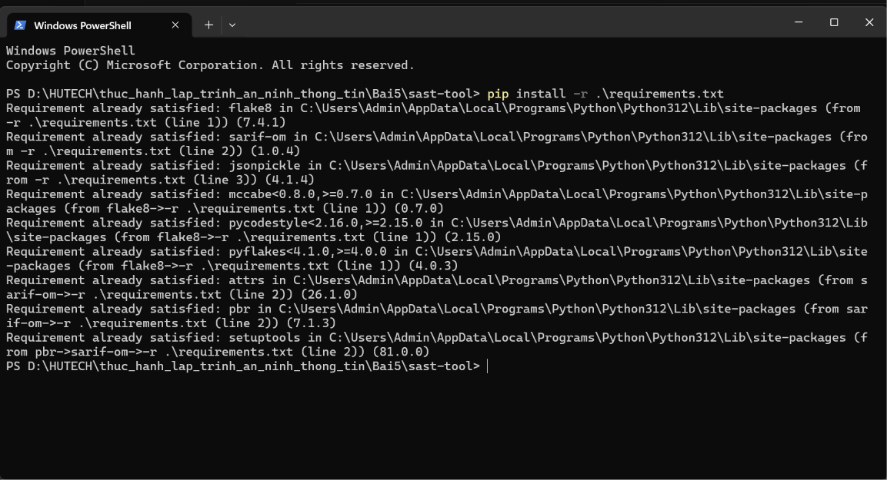
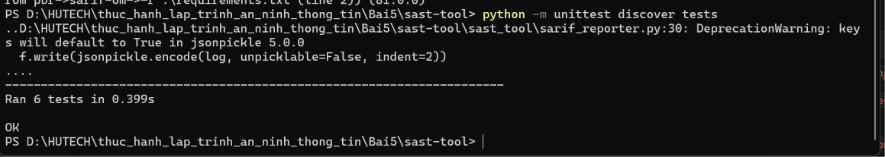
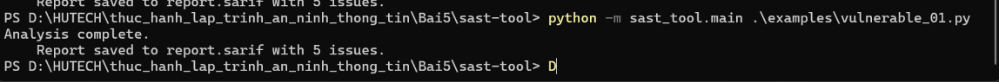
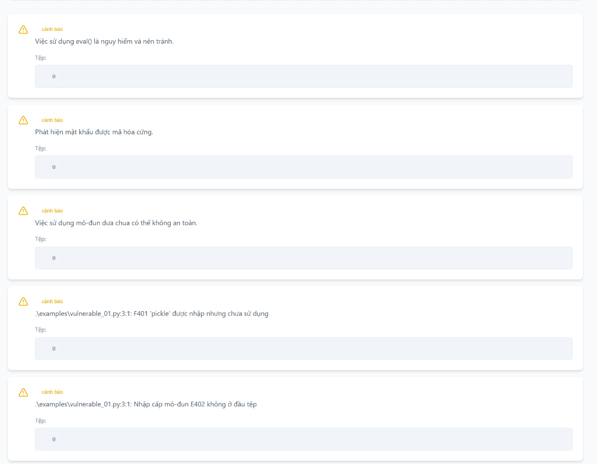
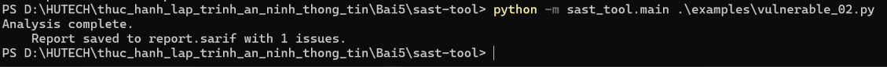
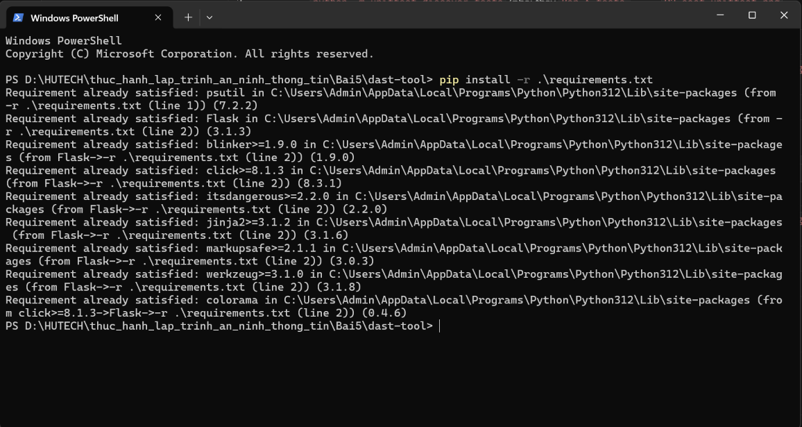
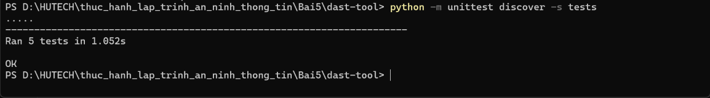
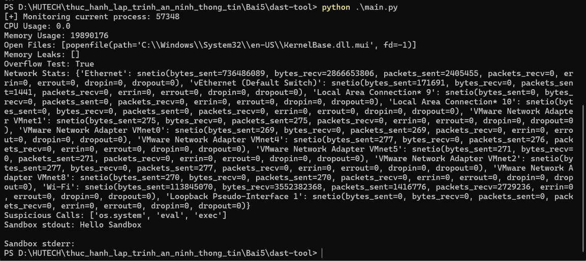
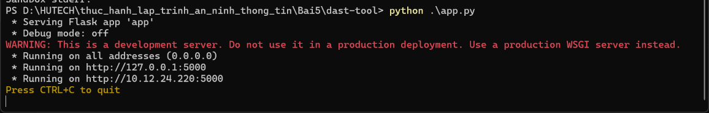
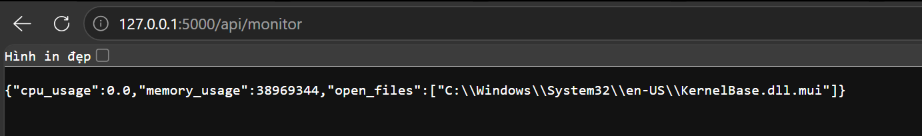

**TRƯỜNG ĐẠI HỌC CÔNG NGHỆ TP HCM**  
**KHOA CÔNG NGHỆ THÔNG TIN**  
**Môn:** Thực hành Lập trình An ninh Thông tin  

---

# BÁO CÁO BÀI 5

**Họ Và Tên:** Hồ Đắc Hiệp  
**MSSV:** 2380600634  
**Lớp:** 23DATA1  

---

# 🔒 Bài 5 — Phân Tích và Kiểm Thử Bảo Mật (SAST & DAST)

## 📋 Mục lục

- [Giới thiệu](#giới-thiệu)
- [Tổng quan công cụ](#tổng-quan-công-cụ)
- [1. SAST-Tool](#1-sast-tool---phân-tích-bảo-mật-tĩnh)
- [2. DAST-Tool](#2-dast-tool---phân-tích-bảo-mật-động)
- [Kết luận](#kết-luận)

---

## Giới thiệu

**Báo cáo Bài 5** tập trung vào việc xây dựng và kiểm thử hai bộ công cụ tương ứng với hai kỹ thuật kiểm thử bảo mật cốt lõi:

1. **sast-tool** (*Static Analysis Security Testing*): phân tích **mã nguồn tĩnh** qua cây cú pháp trừu tượng (AST) và pattern matching để phát hiện lỗ hổng **trước khi** chương trình chạy, sau đó xuất báo cáo theo chuẩn **SARIF**.
2. **dast-tool** (*Dynamic Analysis Security Testing*): quan sát **hành vi ứng dụng khi thực thi** — giám sát CPU/bộ nhớ, lưu lượng mạng, phát hiện lời gọi nguy hiểm và chạy thử trong sandbox cách ly, phơi các chức năng qua REST API (Flask).

Báo cáo trình bày chi tiết cấu trúc project, chức năng từng thành phần, cách vận hành và kết quả kiểm thử của từng công cụ.

---

## Tổng quan công cụ

| STT | Dự án | Các module chính | Kiểm thử |
|---|---|---|---|---|
| 1 | `sast-tool` | ASTAnalyzer, VulnPatternMatcher, SecurityRuleEngine, CodeQualityChecker, SarifReporter | `unittest` (6 test) |
| 2 | `dast-tool` | RuntimeMonitor, MemoryAnalyzer, NetworkTrafficAnalyzer, SecurityBehaviorChecker, VirtualSandbox, Flask API | `unittest` (5 test) |

---

## 1. SAST-Tool - Phân tích bảo mật tĩnh

Công cụ **sast-tool** phân tích mã nguồn Python mà không cần chạy chương trình. Mỗi chức năng được tách thành một module riêng trong thư mục `sast_tool/`, kết quả được hợp nhất rồi xuất ra báo cáo chuẩn SARIF để mở bằng **SARIF Viewer**.

**Cấu trúc project:**

```
sast-tool/
├── requirements.txt            # flake8, sarif-om, jsonpickle
├── examples/                   # mã nguồn mẫu chứa lỗ hổng để kiểm thử
│   ├── vulnerable_01.py
│   └── vulnerable_02.py
├── rules/default_rules.json    # định nghĩa rule + mức độ nghiêm trọng
├── sast_tool/                  # 5 module xử lý + main.py điều phối
└── tests/                      # 6 unit test
```

**Các chức năng chính:**
- **ASTAnalyzer**: dùng `ast.parse` + `ast.walk` duyệt cây cú pháp, phát hiện lời gọi `eval()` cùng vị trí dòng/cột.
- **VulnPatternMatcher**: dùng regex khớp các mẫu nguy hiểm — *hardcoded password* (`password = "..."`) và *import pickle*.
- **SecurityRuleEngine**: nạp `default_rules.json`, gán mức độ nghiêm trọng (`high`/`medium`/`low`) cho từng loại lỗ hổng.
- **CodeQualityChecker**: gọi `flake8` qua `subprocess` để phát hiện các lỗi chất lượng mã (`Lint Issue`).
- **SarifReporter**: dựng đối tượng chuẩn **SARIF 2.1.0** và serialize ra `report.sarif` bằng `jsonpickle`.

### 1.1. Cài đặt môi trường

Mở terminal (PowerShell) tại thư mục `sast-tool` và cài thư viện:

```powershell
pip install -r .\requirements.txt
```



### 1.2. Kiểm thử tự động (Unit Test)

Dự án dùng `unittest` với 6 test case bao phủ cả 5 module.

```powershell
python -m unittest discover tests
```

**Kết quả kiểm thử — toàn bộ 6/6 test PASS:**



### 1.3. Phân tích file mã không an toàn `vulnerable_01.py`

```powershell
python -m sast_tool.main .\examples\vulnerable_01.py
```

Công cụ phát hiện các lỗ hổng (hardcoded password, import pickle, eval) cùng các lint issue và xuất kết quả ra `report.sarif`:



### 1.4. Xem báo cáo bằng SARIF Viewer

Cài extension **SARIF Viewer** trong VS Code, mở file `report.sarif` để xem danh sách kết quả phân tích trực quan (loại lỗi, thông điệp, vị trí dòng):



### 1.5. Kiểm tra với file không an toàn khác `vulnerable_02.py`

```powershell
python -m sast_tool.main .\examples\vulnerable_02.py
```



---

## 2. DAST-Tool - Phân tích bảo mật động

Công cụ **dast-tool** quan sát hành vi của ứng dụng **trong lúc thực thi**. Mỗi thành phần là một module riêng, có thể chạy trực tiếp qua `main.py` (CLI) hoặc truy cập qua REST API trong `app.py` (Flask).

**Cấu trúc project:**

```
dast-tool/
├── requirements.txt              # psutil, Flask
├── runtime_monitor.py            # giám sát CPU / RAM / open files
├── memory_analyzer.py            # phát hiện memory leak & overflow
├── network_traffic_analyzer.py   # thống kê lưu lượng mạng
├── security_behavior_checker.py  # phát hiện lời gọi nguy hiểm
├── virtual_sandbox.py            # thực thi lệnh cách ly
├── main.py                       # chạy toàn bộ giám sát ở CLI
├── app.py                        # Flask API phơi các chức năng
└── tests/                        # 5 unit test
```

**Các chức năng chính:**
- **RuntimeMonitor**: dùng `psutil.Process(pid)` lấy `cpu_percent`, `memory_info().rss`, `open_files()` của tiến trình.
- **MemoryAnalyzer**: `check_memory_leaks()` dùng `gc` tìm đối tượng rác có `__del__`; `check_overflow()` phát hiện số nguyên vượt ngưỡng `2**63`.
- **NetworkTrafficAnalyzer**: `psutil.net_io_counters(pernic=True)` thống kê bytes/packets gửi–nhận theo từng card mạng.
- **SecurityBehaviorChecker**: quét mã tìm các lời gọi nguy hiểm `os.system`, `eval`, `exec`.
- **VirtualSandbox**: tạo thư mục tạm bằng `tempfile.mkdtemp()` và thực thi lệnh cách ly qua `subprocess.run`.

### 2.1. Cài đặt môi trường

Mở terminal tại thư mục `dast-tool` và cài thư viện:

```powershell
pip install -r .\requirements.txt
```



### 2.2. Kiểm thử tự động (Unit Test)

Dự án dùng `unittest` với 5 test case cho cả 5 module.

```powershell
python -m unittest discover -s tests
```

**Kết quả kiểm thử — toàn bộ 5/5 test PASS:**



### 2.3. Chạy giám sát trực tiếp (CLI)

File `main.py` chạy toàn bộ các bộ giám sát trên tiến trình hiện tại và in kết quả ra màn hình:

```powershell
python .\main.py
```

**Kết quả hiển thị CPU/Memory, open files, memory leak, overflow test, thống kê mạng, suspicious call và kết quả sandbox:**



### 2.4. Giám sát qua Flask API

Khởi động server Flask để truy cập các chức năng giám sát qua REST API:

```powershell
python .\app.py
```

Server khởi chạy tại địa chỉ: `http://127.0.0.1:5000/`



### 2.5. Kiểm thử các API endpoint

Giữ nguyên terminal đang chạy server, mở trình duyệt truy cập các endpoint (ví dụ `http://127.0.0.1:5000/api/monitor`) để lấy dữ liệu giám sát dạng JSON:



**Các endpoint khả dụng (lấy trong file `app.py`):**

| Endpoint | Method | Chức năng |
|---|---|---|
| `/api/monitor` | GET | CPU, memory, open files của tiến trình |
| `/api/memory` | GET | Kiểm tra memory leak & overflow |
| `/api/network` | GET | Thống kê lưu lượng mạng |
| `/api/security` | GET | Danh sách lời gọi nghi ngờ |
| `/api/sandbox` | POST | Thực thi lệnh trong sandbox (body JSON `{"command": "..."}`) |

---

## Kết luận

Qua bài thực hành số 5, hai kỹ thuật kiểm thử bảo mật quan trọng đã được áp dụng vào thực tế:

- **Xây dựng SAST-Tool** — phân tích mã nguồn tĩnh qua AST và pattern matching, phát hiện các lỗ hổng (eval, hardcoded password, pickle) cùng lỗi chất lượng mã, và xuất báo cáo chuẩn **SARIF** mở được bằng SARIF Viewer.
- **Xây dựng DAST-Tool** — giám sát hành vi runtime (CPU/RAM, mạng, suspicious call, sandbox cách ly) qua cả giao diện dòng lệnh và REST API Flask.
- Hiểu rõ sự khác biệt và vai trò **bổ trợ** giữa phân tích tĩnh (phát hiện sớm trên mã nguồn) và phân tích động (phát hiện lỗ hổng chỉ xuất hiện khi thực thi) trong quy trình kiểm thử bảo mật phần mềm hiện đại.

> Các ảnh chụp kết quả kiểm thử được lưu trực tiếp tại thư mục `Bai5/images/`.
